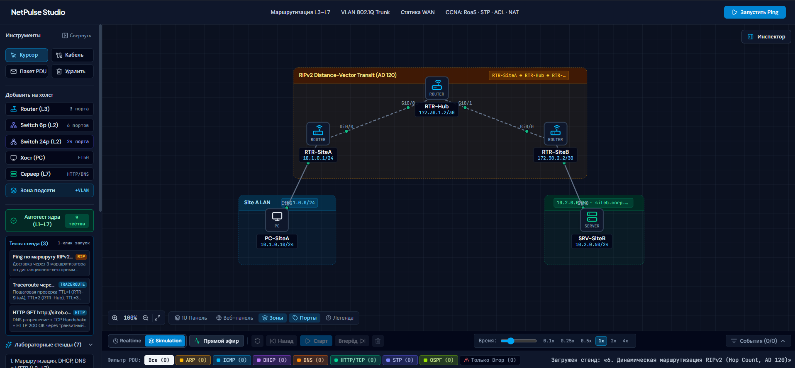

# NetPulse Studio — Интерактивный сетевой симулятор уровней L1–L7 (CCNA Edition)



**NetPulse Studio** — браузерная инженерная среда проектирования, физической коммутации и потоковой/пошаговой симуляции компьютерных сетей уровней **L1–L7** в стиле **Cisco Packet Tracer**. Приложение объединяет интерактивный топологический холст с потоком микро-пакетов в реальном времени, реалистичные аппаратные 1U-панели коммутаторов и маршрутизаторов **Cisco ISR**, плавающие окна настройки оборудования (**VLAN, 802.1Q Router-on-a-Stick, STP 802.1D, OSPFv2 SPF, RIPv2, Static Routes, NAT/PAT, ACL Firewall, DHCP/DNS/HTTP L7**), монитор рабочей станции и сервера, многовкладочный терминал **Cisco IOS CLI** и двухпанельный анализатор событий **Event List & OSI PDU Sniffer**.

---

## Содержание

1. [Архитектура и схема работы приложения](#архитектура-и-схема-работы-приложения)
2. [Жизненный цикл симуляции пакета (L1–L7)](#жизненный-цикл-симуляции-пакета-l1l7)
3. [Что уже реализовано](#что-уже-реализовано)
4. [План дальнейшего развития (Приоритетный Roadmap)](#план-дальнейшего-развития-приоритетный-roadmap)
5. [Структура исходного кода](#структура-исходного-кода)
6. [Стек технологий](#стек-технологий)
7. [Запуск, сборка и модульное тестирование](#запуск-сборка-и-модульное-тестирование)

---

## Архитектура и схема работы приложения

Приложение построено вокруг единого детерминированного состояния топологии (`nodes`, `links`, `zones`), которое синхронизируется между всеми визуальными инструментами управления без задержек и внешних серверных зависимостей. Любое действие — переключение патч-корда на 1U-шасси, создание подинтерфейса `802.1Q` в `Cisco ISR GUI`, настройка IP в мониторе ПК или ввод команды в `Cisco IOS CLI` — мгновенно отражается на холсте и в расчёте маршрутизации пакетов.

```text
+---------------------------------------------------------------------------------------------------+
|                             ЕДИНОЕ СОСТОЯНИЕ ТОПОЛОГИИ (React State)                              |
|                     [ Узлы (Nodes) ]     [ Кабели (Links) ]     [ Зоны (Zones) ]                  |
+-------------------------------------------------+-------------------------------------------------+
                                                  |
        +-----------------------------------------+-----------------------------------------+
        |                                         |                                         |
        v                                         v                                         v
+-------------------------------+   +-----------------------------------+   +-------------------------------+
|   ИНТЕРАКТИВНЫЙ ХОЛСТ СХЕМЫ   |   |   СПЕЦИАЛИЗИРОВАННЫЕ ОКНА УЗЛОВ   |   |    ЯДРО СИМУЛЯЦИИ И ПОТОКОВ   |
|   (TopologyCanvas.tsx)        |   |                                   |   |  (simulator.ts / ipMath.ts /  |
|                               |   | 1. Шасси 1U Switch (+30% Scale)   |   |   packetStreamEngine.ts)      |
| - Перетаскивание узлов и зон  |   |    & Шасси 1U Cisco ISR Router    |   |                               |
| - Поток 10x10 px квадратиков  |   |    (HardwareFrontPanel.tsx)       |   | - L2: CAM, Access/802.1Q,     |
|   пакетов со шлейфами (Live)  |   |                                   |   |   STP 802.1D (Root / BLK)     |
| - Волны Broadcast Fan-Out     |   | 2. Редактор маршрутизатора L3     |   | - L3: RFC 826 ARP, RoaS       |
| - Клик по пакету -> Пауза     |   |    (FloatingRouterGui.tsx)        |   |   Subinterfaces, Static,      |
|   и разбор OSI L1–L7 PDU      |   |    802.1Q, Routes, NAT/PAT, ACL   |   |   DHCP Relay, NAT/PAT, ACL    |
| - Индикация STP BLK и Trunk   |   |                                   |   | - L4–L7: ICMP, Traceroute,    |
+-------------------------------+   | 3. Веб-панель коммутатора L2      |   |   DHCP DORA, DNS, TCP + HTTP  |
                                    |    (FloatingSwitchWebGui.tsx)     |   +---------------+---------------+
                                    |                                   |                   |
                                    | 4. Монитор ПК (Сеть / CMD / Web)  |                   v
                                    |    (FloatingPcMonitor.tsx)        |   +-------------------------------+
                                    |                                   |   |  ПАНЕЛЬ ПАКЕТОВ И ИНСПЕКТОР   |
                                    | 5. Многовкладочный Cisco IOS CLI  |   |  (SimulationTimelineBar.tsx   |
                                    |    (FloatingCliWindow.tsx)        |   |   + PduInspectorModal.tsx)    |
                                    +-----------------------------------+   |                               |
                                                                            | - Режимы Realtime/Simulation  |
                                                                            | - Скорость 0.1x Slow-Mo .. 4x |
                                                                            | - Фильтры: ARP/ICMP/DHCP/DNS/ |
                                                                            |   HTTP/STP и Только Drop      |
                                                                            | - Event List + Сравнение      |
                                                                            |   Inbound vs Outbound PDU     |
                                                                            +-------------------------------+
```

---

## Жизненный цикл симуляции пакета (L1–L7)

При запуске любой сетевой операции (`Ping`, `Traceroute`, `DHCP DORA`, `HTTP Browser`, `CLI ping <domain>` или генератора `Прямой эфир`) ядро симуляции (`src/network/simulator.ts` и `src/network/packetStreamEngine.ts`) вычисляет полную цепочку прохождения кадров и пакетов через сеть:

```text
[Отправитель: PC / Server / Router]
       |
       +-- 1. Прикладной уровень и DNS-резолвинг (L7):
       |      - Если цель задана доменным именем (в браузере или в CLI `ping <domain>`),
       |        проверяется доступность DNS-сервера и по сети отправляется реальный
       |        пакет DNS_QUERY / DNS_RESPONSE.
       |
       +-- 2. Выбор интерфейса и проверка шлюза (L3):
       |      - На маршрутизаторе исходящий интерфейс и Source IP выбираются через
       |        Longest Prefix Match (`findBestRoute`).
       |      - На конечном узле проверяется принадлежность Default Gateway к локальной
       |        подсети интерфейса (`isSameSubnet`). Если шлюз в чужой подсети —
       |        немедленный возврат `Network is unreachable` без ложного ARP-флуда.
       |
       +-- 3. Разрешение физического адреса по RFC 826 (ARP):
       |      - Поиск MAC-адреса следующего перехода в ARP-кэше.
       |      - При отсутствии записи отправляется `ARP_REQUEST` (FF:FF:FF:FF:FF:FF).
       |      - Обновление ARP-таблиц на узлах сегмента выполняется строго по RFC 826
       |        (только у целевого IP или при обновлении уже существующей записи,
       |        игнорируя 0.0.0.0 при DHCP Discover).
       |
       +-- 4. Коммутация L2, IEEE 802.1Q VLAN и защита от петель STP 802.1D:
       |      - Вычисляется топология Spanning Tree (`computeSpanningTreeState`):
       |        выбирается Root Bridge, назначаются роли портов Root / Designated /
       |        Alternate (Blocking). Порты в состоянии `STP BLK` блокируют пересылку
       |        кадров данных и предотвращают широковещательный шторм.
       |      - Коммутатор обучает таблицу MAC (CAM) и выполняет тегирование `802.1Q`
       |        на магистральных Trunk-портах.
       |
       +-- 5. Маршрутизация L3, Router-on-a-Stick, DHCP Relay, ACL и NAT/PAT:
       |      - Поддержка подинтерфейсов `Fa0/0.10`, `Fa0/0.20` (`encapsulation dot1Q`)
       |        для маршрутизации между VLAN по одному Trunk-кабелю.
       |      - При получении широковещательного `DHCP_DISCOVER` на интерфейсе с
       |        `ip helper-address` маршрутизатор ретранслирует запрос к центральному
       |        DHCP-серверу в другой подсети.
       |      - Проверка пакетов по списку правил **Extended ACL** (`permit` / `deny`
       |        по протоколам ICMP, TCP, UDP, HTTP, DNS и префиксам IPv4) с фиксацией
       |        шага `ACL Drop`.
       |      - При переходе из зоны `NAT Inside` в `NAT Outside` выполняется трансляция
       |        `Inside Local IP` -> `Inside Global IP` (PAT Overload) с записью сессии
       |        в таблицу `show ip nat translations`.
```

---

## Что уже реализовано

### 1. Сетевое ядро и протоколы уровня CCNA (L1–L7)
* **Канальный уровень (L2):**
  * Динамическое изучение MAC-адресов (CAM-таблица), изоляция портов `Access VLAN` и магистральное тегирование **IEEE 802.1Q Trunk**.
  * **Spanning Tree Protocol (STP IEEE 802.1D):** автоматический выбор `Root Bridge` по приоритету (`stpPriority`) и MAC-адресу, расчёт стоимости пути (`Root Path Cost`), перевод резервных портов кольца в состояние `Alternate / Blocking (BLK)` и генерация служебных кадров `STP_BPDU`.
* **Сетевой уровень (L3):**
  * **Динамическая маршрутизация OSPFv2 (Single-Area 0) и RIPv2:** рассылка пакетов `OSPF_HELLO` / `OSPF_LSA`, таблица соседства `show ip ospf neighbor`, алгоритм Дейкстры (SPF) с расчётом стоимости `Cost = 100 Mbps / Bandwidth`, автоматическое перестроение маршрутов при обрыве линка и дистанционно-векторный `RIPv2` (AD 120, метрика Hop Count).
  * **Router-on-a-Stick (802.1Q Subinterfaces):** создание виртуальных подинтерфейсов (`Fa0/0.10`, `Fa0/0.20`) для межсетевой маршрутизации между VLAN.
  * **DHCP Relay (`ip helper-address`):** пересылка широковещательных запросов DHCP через маршрутизатор к централизованному DHCP-серверу.
  * **NAT / PAT (Port Address Translation):** разделение интерфейсов на `ip nat inside` и `ip nat outside`, подмена Source/Destination IP в заголовках пакетов L3 и живая таблица трансляций `show ip nat translations`.
  * **Межсетевой экран Extended IPv4 ACL:** фильтрация трафика по номеру последовательности (`seq`), действию (`permit` / `deny`), протоколу (`ICMP`, `TCP`, `UDP`, `HTTP`, `DNS`, `ANY`) и адресам/префиксам CIDR с визуализацией `ACL Drop`.
  * **Строгая валидация стека IPv4 / RFC 826:** проверка подсети шлюза по умолчанию, защита ARP-кэша от загрязнения широковещательными кадрами, выбор `Source IP` маршрутизатора по таблице маршрутизации и контроль исчерпания пула адресов DHCP (`DHCP Pool Exhausted`).
* **Транспортный и прикладной уровни (L4–L7):**
  * **ICMP Ping** и пошаговый **Traceroute** (`TTL=1, 2, 3...` с ответами `ICMP_TIME_EXCEEDED`);
  * **DHCP (DORA):** `Discover` → `Offer` → `Request` → `Ack` с выдачей IP, маски, шлюза и DNS;
  * **DNS + TCP 3-Way Handshake + HTTP:** честное разрешение доменных имён (как в веб-браузере, так и в CLI `ping <domain>`), установка TCP-соединения и загрузка веб-страницы `HTTP GET / 200 OK`.

### 2. Потоковая визуализация пакетов и таймлайн в стиле Cisco Packet Tracer
* **Multi-Packet Live Stream (`TopologyCanvas.tsx` + `packetStreamEngine.ts`):**
  * Одновременная отрисовка множества бегущих пакетов-квадратиков (`10×10 px`, скругление `2px`, неоновый шлейф движения вдоль линии кабеля и разделение встречных полос Full-Duplex).
  * Цветовая индикация по протоколам: `ARP` (янтарный), `ICMP` (голубой), `DHCP` (фиолетовый), `DNS` (оранжевый), `HTTP/TCP` (изумрудный), `STP BPDU` (индиго), `OSPF` (лаймовый), `Drop` (красный со знаком `×`).
  * Одновременное размножение квадратиков веером по всем активным портам при широковещательной рассылке (`Broadcast Fan-Out`).
  * **Клик по любому бегущему квадратику на кабеле** ставит симуляцию на паузу, выделяет узел и открывает детальный разбор пакета по модели OSI L1–L7.
* **Управление временем и режимами (`SimulationTimelineBar.tsx`):**
  * Переключатель режимов **`Realtime`** (непрерывный поток) и **`Simulation`** (пошаговый захват).
  * Генератор **`Прямой эфир (Multi-Flow)`**, непрерывно запускающий пакеты `STP BPDU`, `OSPF Hello`, `ARP`, `ICMP`, `DNS` и `HTTP` между активными узлами схемы.
  * Плавный ползунок скорости времени и быстрые пресеты **`0.1x` (Slow-Mo), `0.25x`, `0.5x`, `1x`, `2x`, `4x`**.
* **Фильтрация протоколов (`Фильтр PDU`) и двухпанельный `Event List & PDU Diff Sniffer`:**
  * Чипы фильтрации со счётчиками пакетов: `Все`, `ARP`, `ICMP`, `DHCP`, `DNS`, `HTTP/TCP`, `STP`, `OSPF` и `Только Drop`.
  * Таблица событий с поиском по IP/MAC/имени узла, фильтром по устройству (`At Device`) и встроенной правой панелью мгновенного сравнения **`Inbound PDU` vs `Outbound PDU`** (подсветка `L2 MAC Rewrite`, `+802.1Q VLAN Tag`, `NAT / PAT IP`, `TTL -1 Hop`).

### 3. Специализированные плавающие окна оборудования (без дублирующего бокового инспектора)
* **Маршрутизатор Cisco ISR 1U + плавающий редактор `Cisco ISR GUI` (`HardwareFrontPanel.tsx` + `FloatingRouterGui.tsx`):**
  * Аппаратная передняя панель 1U шасси `ISR-2911-SEC/K9` с индикаторами `SYS`, `ACT`, `VPN`, `NAT`, `ACL`, `802.1Q`, консольным портом `CON`, кнопкой `ISR GUI`, слотами расширения `+ HWIC Порт` и индивидуальными экранированными портами `LAN / WAN`.
  * Шестивкладочный визуальный редактор L3: **«Порты и 802.1Q»**, **«Static Routes»**, **«OSPF / RIP»** (таблица соседей и сети Area 0), **«NAT / PAT»**, **«ACL Firewall»** и **«DHCP / ARP»** (пулы DHCP-сервера роутера и живая таблица `show ip arp`).
* **Монитор персонального компьютера и сервера (`FloatingPcMonitor.tsx`):**
  * Окно монитора с вкладками **«Сеть и ARP»** (умный ввод IPv4/маски, DHCP DORA и таблица ARP-кэша), **«Службы L7 (HTTP · DNS · DHCP)»** (для серверов), **«Консоль (CMD)»** (`ipconfig /all`, `ping`, `tracert`, `arp -a`, `nslookup`, `ipconfig /renew`) и **«Браузер»**.
* **Увеличенное (+30%) 1U-шасси и Веб-интерфейс коммутатора (`FloatingSwitchWebGui.tsx`):**
  * Двухрядная матрица разъёмов RJ-45 (6 и 24 порта) с индикацией `STP ROOT` и оранжевыми светодиодами заблокированных портов `STP BLK`.
  * Групповая настройка портов (`Bulk Configuration`), управление базой данных VLAN и просмотр таблицы MAC-адресов.
* **Многовкладочный терминал Cisco IOS CLI (`FloatingCliWindow.tsx`):**
  * Поддержка команд настройки интерфейсов, подинтерфейсов `interface Fa0/0.10`, `router ospf 1` (`network <ip> <wildcard> area 0`), `ip helper-address`, `ip route`, `ip nat inside/outside`, `access-list`, `spanning-tree priority`, автодополнения по `Tab` и истории команд.

---

## План дальнейшего развития (Приоритетный Roadmap)

Ниже представлен пошаговый план развития **NetPulse Studio** в порядке инженерного приоритета:

### ✅ Этап 1. Динамическая маршрутизация L3 (OSPFv2 Single-Area & RIPv2) — *[Реализовано]*
1. **Протокол OSPF (Open Shortest Path First) и RIPv2:**
   * Обмен служебными пакетами `OSPF Hello / LSA` между соседними маршрутизаторами и формирование таблицы соседей (`show ip ospf neighbor`).
   * Автоматическое построение графа сети (LSDB) и расчёт кратчайших маршрутов по алгоритму Дейкстры (SPF, `Cost = 100 Mbps / BW`) с добавлением записей типа `O` и `R` в таблицу маршрутизации и автоматическим переключением при обрыве кабеля.
   * Вкладка `OSPF / RIP` в окне `Cisco ISR GUI`, команды `router ospf 1` в CLI и 7 лабораторных стендов с автотестами ядра (`9/9`).

### ✅ Этап 2. Коммутаторы уровня L3 (Multilayer Switch / SVI) и агрегация каналов (EtherChannel / LACP) — *[Реализовано]*
2. **Маршрутизирующие коммутаторы L3 (Switch Virtual Interfaces — SVI):**
   * Поддержка виртуальных интерфейсов `interface Vlan10`, `interface Vlan20` с назначением IP-адресов шлюзов, `ip helper-address` (DHCP Relay) и команды `ip routing` непосредственно на ядре коммутации (`SW-Core-L3`) без необходимости внешнего Router-on-a-Stick.
3. **EtherChannel / LACP (IEEE 802.3ad):**
   * Объединение 2–4 физических портов между коммутаторами в единый логический агрегированный канал `Port-channel1 (Po1)` (`channel-group 1 mode active`), который воспринимается протоколом STP как один логический линк с суммарной пропускной способностью (`200M` / `2G`), не блокируется в `STP BLK` и отображается на холсте фирменным овальным кольцом поверх агрегированных кабелей.

### 🔜 Этап 3. Канальная безопасность (L2 Security: Port Security & DHCP Snooping) — *[Следующий по очереди]*
4. **Cisco Port Security на Access-портах коммутатора:**
   * Ограничение максимального числа MAC-адресов на порту (`switchport port-security maximum`), привязка `Sticky MAC` и перевод порта в состояние `err-disabled` (с мигающим красным индикатором на 1U-панели) при подключении неавторизованного хоста.
5. **DHCP Snooping и защита от подмены DHCP-сервера (Rogue DHCP):**
   * Разделение портов коммутатора на `Trusted` (Uplink к легитимному серверу/маршрутизатору) и `Untrusted` (пользовательские порты) с блокировкой пакетов `DHCP_OFFER` / `DHCP_ACK` со стороны недоверенных портов.

### Этап 4. Система учебных лабораторных заданий с автопроверкой (Lab Grader)
6. **Движок пошаговых заданий и автоматической верификации (Assessment Mode):**
   * Панель лабораторного задания с чек-листом целей (например: *«Настройте VLAN 10 и 20 на коммутаторе», «Поднимите подинтерфейсы Fa0/0.10 и Fa0/0.20 на роутере», «Разрешите доступ по HTTP к серверу и заблокируйте ICMP через ACL»*).
   * Автоматический валидатор состояния топологии и результатов симуляции с прогресс-баром выполнения (`0% -> 100%`) и подсказками по диагностике ошибок.

### Этап 5. Поддержка Dual-Stack IPv6 и беспроводного сегмента (Wi-Fi AP)
7. **Стек IPv6 и ICMPv6 NDP / SLAAC:**
   * Назначение адресов IPv6 (`2001:db8::/64`, `fe80::` Link-Local), замена ARP на протокол обнаружения соседей `ICMPv6 Neighbor Solicitation / Neighbor Advertisement` и автоконфигурация хостов по SLAAC.
8. **Точки доступа Wi-Fi (Wireless Access Point) и беспроводные клиенты:**
   * Визуализация радиуса покрытия SSID, шифрования WPA2/WPA3 и беспроводных волн передачи кадров между ноутбуками и точкой доступа.

---

## Структура исходного кода

```text
src/
├── App.tsx                             # Корневой компонент, цикл времени симуляции (0.1x–4x) и координация окон
├── main.tsx                            # Точка входа React-приложения
├── index.css                           # Глобальные стили, шрифты и сетка рабочего пространства
├── components/
│   ├── TopologyCanvas.tsx              # Интерактивный холст, поток 10x10 px пакетов, овальные кольца LACP Po1 и редактор зон
│   ├── HardwareFrontPanel.tsx          # Плавающее 1U-шасси коммутаторов (+30%) и маршрутизаторов Cisco ISR
│   ├── FloatingRouterGui.tsx           # Плавающий ГУИ маршрутизатора Cisco ISR (802.1Q, Static, OSPF/RIP, NAT, ACL, DHCP/ARP)
│   ├── FloatingSwitchWebGui.tsx        # Плавающий веб-интерфейс коммутатора (Порты, VLAN DB, L3 SVI & LACP Po#, MAC-таблица)
│   ├── FloatingPcMonitor.tsx           # Экран монитора ПК и Сервера (Сеть и ARP, Службы L7 HTTP/DNS/DHCP, CMD, Браузер)
│   ├── FloatingCliWindow.tsx           # Многовкладочный терминал Cisco IOS CLI с автодополнением Tab
│   ├── DeviceToolbar.tsx               # Сворачиваемая левая панель оборудования, 8 стендов и автотестов ядра (10/10)
│   ├── SimulationTimelineBar.tsx       # Панель Realtime/Simulation, скорость 0.1x–4x, фильтры и Event List + Diff
│   └── PduInspectorModal.tsx           # Модальное окно глубокого разбора заголовков пакета OSI L1–L7
└── network/
    ├── types.ts                        # Строгие типы данных узлов, портов, VLAN, SVI, LACP, STP, OSPF/RIP, NAT, ACL и шагов
    ├── ipMath.ts                       # Расчёт подсетей IPv4, CIDR, автоформатирование IP и автоподбор масок
    ├── hardwareChassis.ts              # Логика 1U-шасси, матрицы портов RJ-45 и базы данных VLAN
    ├── routerGuiHelpers.ts             # Чистые функции управления 802.1Q подинтерфейсами, маршрутами, OSPF, NAT и ACL
    ├── packetStreamEngine.ts           # Движок потока микро-пакетов, волн Broadcast, STP BPDU, OSPF Hello/LSA, фильтров и Diff PDU
    ├── simulator.ts                    # Детерминированное ядро симуляции L1–L7 (RFC 826 ARP, STP, LACP Po#, L3 SVI, OSPFv2, RIPv2, NAT, ACL)
    ├── cliParser.ts                    # Парсер команд Cisco IOS CLI (включая ip routing, interface VlanX, channel-group), DNS в CLI
    ├── presets.ts                      # 8 готовых лабораторных стендов с тестовыми сценариями в 1 клик
    └── simulator.test.ts               # Полный набор из 28 модульных тестов сетевого ядра, протоколов и ГУИ
```

---

## Стек технологий

* **Язык программирования:** TypeScript 5.8 (строгая типизация всех сетевых заголовков и протоколов)
* **Пользовательский интерфейс:** React 19
* **Стилизация:** Tailwind CSS 4
* **Иконографика:** Lucide React
* **Сборка и сервер разработки:** Vite 6
* **Модульное тестирование:** встроенный тестовый раннер Node.js (`node:test` + `tsx`, 28 автотестов)

---

## Запуск, сборка и модульное тестирование

### Установка зависимостей
```bash
npm install
```

### Запуск сервера разработки
```bash
npm run dev
```
Приложение будет доступно по адресу `http://localhost:3000`.

### Запуск модульных тестов сетевого ядра (28 тестов)
```bash
npx tsx --test src/network/simulator.test.ts
```

### Проверка типов и сборка production-бандла
```bash
npm run lint
npm run build
```
